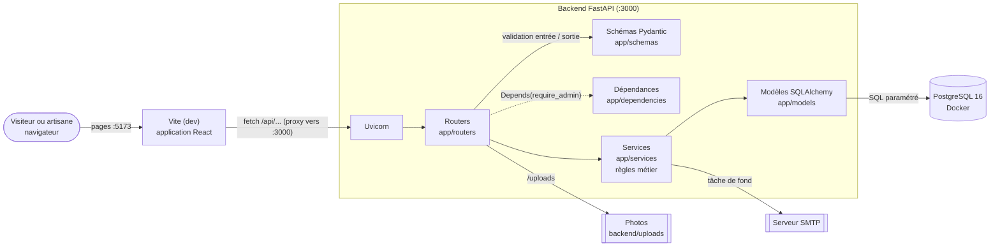
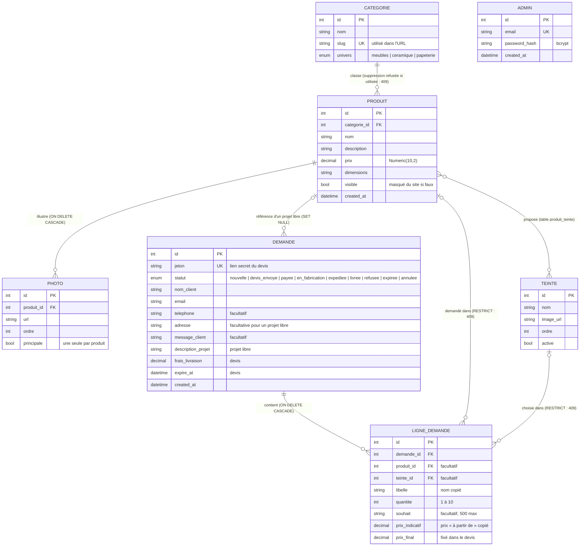

# Maison Guillard

Application web pour une artisane menuisière : elle présente et vend ses meubles faits main
(tables, tabourets, bancs, luminaires). C'est mon projet de portfolio Holberton School, réalisé
seul.

Tout est fabriqué à la commande, il n'y a pas de stock. Le parcours d'un visiteur :

- il compose **« Ma demande »** (une ou plusieurs pièces, avec une finition et un souhait pour chacune)
  ou envoie un **projet libre** depuis la page Contact ;
- l'artisane fixe le prix final et envoie un **devis** ;
- le client le consulte par un **lien secret** reçu par e-mail.

L'artisane gère le catalogue et les demandes depuis un **back-office** protégé par mot de passe.
Les clients n'ont pas de compte.

## Sommaire

1. [Fonctionnalités](#fonctionnalités)
2. [Technologies et choix](#technologies-et-choix)
3. [Architecture de l'application](#architecture-de-lapplication)
4. [Diagramme de la base de données](#diagramme-de-la-base-de-données)
5. [API REST](#api-rest)
6. [Sécurité](#sécurité)
7. [Installation en local](#installation-en-local)
8. [Tests](#tests)
9. [Organisation du dépôt](#organisation-du-dépôt)
10. [Méthode de travail et Git](#méthode-de-travail-et-git)
11. [Limites connues](#limites-connues)

---

## Fonctionnalités

**Site public**

- Page d'accueil (vitrine), pages « Qui sommes-nous » et « Contact ».
- Boutique en trois univers fixes (Meubles, Céramique, Papeterie), chacun avec ses catégories
  (`/boutique/<univers>/<catégorie>`).
- Fiche produit avec galerie de photos et choix de la finition (teinte). Tout est fabriqué à la
  commande : prix affiché « À partir de X € », fabrication et livraison sous 15 jours après paiement.
- Un produit masqué (`visible = false`) disparaît du site mais reste dans le back-office.
- « Ma demande » (ancien panier, sauvegardée dans le navigateur) : plusieurs pièces de n'importe quel
  univers, une finition et un souhait libre par pièce. Rien n'est payé : le client reçoit son devis
  sous 48 h.
- Projet libre depuis la page Contact (sans pièce du catalogue).
- Page du devis par lien secret : `/devis/<jeton>` montre l'état à jour de la demande, le devis
  (prix finaux, livraison, message, PDF) et permet de le refuser.
- E-mails automatiques (accusé de réception au client avec le lien, notification à l'artisane).

**Back-office** (`/admin`)

- Connexion de l'administratrice.
- Produits : création, modification, suppression, visibilité, finitions proposées, ajout de photos
  et choix de la photo principale.
- Catégories : création, modification (nom, adresse, univers) et suppression.
- Teintes (finitions) : création avec image, activation/désactivation, suppression.
- Demandes : liste filtrée par statut, détail (finition, souhait, projet libre), changements de
  statut contrôlés par l'API (transition interdite = 409).
- Devis : prix final de chaque pièce, lignes libres, frais de livraison pré-remplis, message avec
  messages types, aperçu du PDF exact, envoi par e-mail (PDF en pièce jointe), « Modifier et
  renvoyer » tant que le client n'a pas payé. Numéros `D-<année>-<compteur>` sans doublon.
- Réglages du devis : identité de l'entreprise (nom légal, adresse, SIRET, e-mail obligatoires pour
  envoyer), validité, frais par univers, conditions, messages types.

---

## Technologies et choix

| Couche | Technologie | Pourquoi ce choix |
|---|---|---|
| Frontend | **React 19** + **React Router 7**, construit avec **Vite** | Composants réutilisables (carte produit, formulaires) ; Vite démarre vite et fournit un proxy de développement. |
| Backend | **Python 3.14** + **FastAPI** | Validation des données intégrée (Pydantic) et documentation Swagger générée automatiquement à `/docs`. |
| Serveur | **Uvicorn** (serveur ASGI) | C'est lui qui reçoit les requêtes HTTP et les transmet à FastAPI. |
| Validation | **Pydantic 2** | Chaque donnée qui entre ou sort de l'API est vérifiée par un schéma. Une donnée invalide renvoie 422 avant d'atteindre le code métier. |
| Base de données | **PostgreSQL 16** (dans Docker) | Base relationnelle : les commandes, produits et devis sont liés par des clés étrangères. Les types énumérés et les règles de suppression sont garantis par la base elle-même. |
| ORM et migrations | **SQLAlchemy 2** + **Alembic** | Des classes Python au lieu de SQL écrit à la main, avec des requêtes paramétrées (protection contre l'injection SQL). Chaque changement de schéma est versionné. |
| Authentification | **JWT** (python-jose, HS256) + **bcrypt** (passlib) | Jeton signé, valable 8 h, sans session à stocker côté serveur. Les mots de passe sont hachés et salés. |
| E-mails | **smtplib** + `BackgroundTasks` de FastAPI | Envoyés après la réponse : une panne SMTP n'annule jamais une commande. |
| Tests | **pytest** + `TestClient` (backend), **node:test** (frontend) | Tests unitaires et d'intégration, sans dépendance ajoutée côté frontend. |

**Changement de stack.** Le projet a démarré en Node.js/Express/Prisma, comme prévu dans la
documentation technique (jalon du 10 septembre). Il est passé à Python/FastAPI/SQLAlchemy dès le
premier sprint (commit `2341dbf`), avant d'écrire du code métier. Le modèle de données et la liste
des routes de la documentation technique n'ont pas changé.

---

## Architecture de l'application



**Rôle de chaque couche**

| Couche | Dossier | Rôle | Exemple |
|---|---|---|---|
| Router | `app/routers/` | Reçoit la requête HTTP, appelle le service, choisit le code de réponse (201, 404, 409…). | `routers/commandes.py` |
| Schéma | `app/schemas/` | Décrit ce qui entre (`…In`) et ce qui sort (`…Out`). Le schéma de sortie sert de liste blanche : `password_hash` n'est jamais renvoyé. | `LigneCommandeIn` : quantité de 1 à 10 |
| Dépendance | `app/dependencies/` | Code partagé injecté par FastAPI avec `Depends` : la session de base (`get_db`) et la vérification du jeton (`require_admin`). | `require_admin.py` |
| Service | `app/services/` | Les règles métier, sans rien savoir de HTTP. Il lève des exceptions métier que le router traduit en codes HTTP. | le prix d'une commande est relu en base, jamais pris dans la requête |
| Modèle | `app/models/` | La structure d'une table et ses relations. | `Produit`, `Commande` |

**Une requête de bout en bout** (le visiteur ouvre la boutique) :

1. React appelle `fetch('/api/produits')`. En développement, le proxy de Vite transmet la requête
   à `localhost:3000`, ce qui évite le blocage CORS (même origine pour le navigateur).
2. Uvicorn reçoit la requête et la passe à FastAPI, qui choisit la route `GET /api/produits`.
3. Le router appelle `produit_service.list(...)` avec les filtres de l'URL.
4. Le service interroge la base avec SQLAlchemy. PostgreSQL renvoie des lignes, que SQLAlchemy
   transforme en objets `Produit`.
5. FastAPI passe ces objets dans le schéma `ProduitOut`, puis les convertit en JSON.
6. React affiche les cartes produit.

**Frontend** (`frontend/src/`) : `pages/` (une page par route), `components/` (morceaux
réutilisables), `context/` (état partagé : panier dans le `localStorage`, jeton admin dans le
`sessionStorage`), `api/` (un fichier par ressource, tous passent par `api/client.js`), `utils/`
(règles d'affichage pures, testées).

---

## Diagramme de la base de données



**Les décisions à retenir**

- **`ligne_demande` porte la demande d'une pièce** : produit, quantité, finition choisie et souhait.
  Le nom du produit, le nom de la teinte et le prix « à partir de » y sont **copiés** : changer le
  catalogue ensuite ne modifie jamais une demande déjà envoyée. Les totaux ne sont pas stockés,
  ils sont recalculés (`@property`).
- **Le jeton** est une chaîne aléatoire de 32 octets (`secrets.token_urlsafe`) : c'est le seul accès
  du client à sa demande. L'API publique ne le renvoie jamais.
- **Les statuts sont contrôlés par le service** : un changement non prévu répond 409. Un devis
  dont la date est dépassée devient « expiré » à la lecture (pas de tâche planifiée).
- **Règles de suppression :**
  - supprimer un produit **supprime ses photos** (`CASCADE`) ;
  - supprimer un produit ou une teinte déjà demandés est **refusé** (409) : on les masque ou on les
    désactive ;
  - supprimer un produit **garde les projets libres** qui le référencent (`SET NULL`).
- **Supprimer une catégorie encore utilisée est refusé** (409) par le service.
- **Les statuts et l'univers sont des types énumérés PostgreSQL** : la base refuse toute
  autre valeur.
- **`admin` est isolée** : un seul compte administrateur.
- Le schéma est créé par **4 migrations Alembic** (`backend/alembic/versions/`), appliquées avec
  `alembic upgrade head`.

---

## API REST

Toutes les routes commencent par `/api`. 🔒 = réservé à l'administratrice (en-tête
`Authorization: Bearer <jeton>`, sinon **401**). La documentation interactive complète est sur
http://localhost:3000/docs.

| Ressource | Méthode et URL | Accès | Réponses principales |
|---|---|---|---|
| Santé | `GET /api/health` | public | 200 |
| Authentification | `POST /api/auth/login` | public | 200 `{token}`, 401 |
| Catégories | `GET /api/categories` | public | 200 |
| | `POST /api/categories` | 🔒 | 201, 409 slug déjà pris, 422 |
| | `PUT /api/categories/{id}` (mise à jour partielle) | 🔒 | 200, 404, 409 slug déjà pris, 422 |
| | `DELETE /api/categories/{id}` | 🔒 | 204, 404, 409 catégorie utilisée |
| Produits | `GET /api/produits?univers=&categorie=` | public (produits visibles) | 200, 422 filtre invalide |
| | `GET /api/produits/{id}` | public | 200, 404 (inconnu ou masqué) |
| | `GET /api/produits/admin`, `GET /api/produits/admin/{id}` | 🔒 | 200, 404 (masqués compris) |
| | `POST /api/produits` | 🔒 | 201, 422 |
| | `PUT /api/produits/{id}` (mise à jour partielle) | 🔒 | 200, 404, 422 |
| | `DELETE /api/produits/{id}` | 🔒 | 204, 404, 409 produit déjà commandé |
| Teintes | `GET /api/teintes` | 🔒 | 200 |
| | `POST /api/teintes` (nom, ordre, image) | 🔒 | 201, 422 |
| | `PUT /api/teintes/{id}` · `POST /api/teintes/{id}/image` | 🔒 | 200, 404 |
| | `DELETE /api/teintes/{id}` | 🔒 | 204, 404, 409 proposée par des produits |
| Photos | `POST /api/produits/{id}/photos` (fichier) | 🔒 | 201, 404 |
| | `PATCH /api/photos/{id}/principale` | 🔒 | 200, 404 |
| | `DELETE /api/photos/{id}` | 🔒 | 204, 404 |
| Demandes | `POST /api/demandes` | public | 201, 422 (validation, produit introuvable ou masqué, finition non proposée) |
| | `POST /api/demandes/projet-libre` | public | 201, 422 |
| | `GET /api/demandes/suivi/{jeton}` | public (lien secret) | 200, 404 |
| | `GET /api/demandes?statut=` · `GET /api/demandes/{id}` | 🔒 | 200, 404, 422 |
| | `PATCH /api/demandes/{id}/statut` | 🔒 | 200, 404, 409 transition interdite |
| | `POST /api/demandes/{id}/devis` (envoi ou renvoi) · `POST /api/demandes/{id}/devis/apercu` · `GET /api/demandes/{id}/devis.pdf` | 🔒 | 200, 404, 409 déjà payée, 422 réglages incomplets ou lignes invalides |
| | `GET /api/demandes/suivi/{jeton}/devis.pdf` · `POST /api/demandes/suivi/{jeton}/refuser` | public (lien secret) | 200, 404, 409 |
| Réglages | `GET/PUT /api/reglages-devis` · `GET/POST /api/messages-types` · `PUT/DELETE /api/messages-types/{id}` | 🔒 | 200, 201, 204, 404, 422 |

**Sens des codes d'erreur** : 401 = pas de jeton valide ; 404 = l'élément de l'URL n'existe pas ;
409 = la demande est valide mais contredit une règle métier (conflit) ; 422 = les données envoyées
sont invalides.

---

## Sécurité

- **Mots de passe hachés avec bcrypt** : un sel aléatoire et un coût de calcul sont inclus dans le
  hash. On ne stocke jamais le mot de passe, on recalcule et on compare.
- **Même message pour un e-mail inconnu et un mauvais mot de passe** (« Identifiants invalides ») :
  impossible de deviner quels e-mails ont un compte.
- **JWT signé** avec un secret côté serveur (`JWT_SECRET`), expiration 8 h. `require_admin`
  protège les 15 routes d'écriture et d'administration ; un jeton absent, falsifié ou expiré donne
  401. Un test vérifie chaque route admin sans jeton et avec un faux jeton.
- **Le prix n'est jamais pris dans la requête** : il est relu en base. Un test manuel envoie un faux
  prix dans la requête et vérifie qu'il est ignoré.
- **Validation Pydantic** sur toutes les entrées (e-mail, longueurs, quantité de 1 à 10, champs
  vides refusés même remplis d'espaces).
- **ORM avec requêtes paramétrées** : pas de concaténation de SQL, donc pas d'injection SQL.
- **Schémas de sortie en liste blanche** : seules les colonnes déclarées sont renvoyées.
- **Secrets hors du dépôt** : `.env` est ignoré par git, `.env.example` liste les variables sans
  leurs valeurs.
- **Côté navigateur** : le jeton admin est dans le `sessionStorage` (effacé à la fermeture), et
  l'application se déconnecte toute seule si l'API répond 401. Les contrôles du frontend sont
  seulement un confort : c'est le backend qui fait foi.

Limites et améliorations prévues (limitation du nombre de requêtes, HTTPS, validation du prix) :
voir [Limites connues](#limites-connues) et [docs/evolutions-futures.md](docs/evolutions-futures.md).

---

## Installation en local

**Prérequis** : Docker Desktop, Python 3.14, Node.js 25, Git. Les commandes sont pour PowerShell
(Windows).

1. **La base de données**

   ```powershell
   docker compose up -d        # PostgreSQL sur localhost:5432
   ```

2. **Le backend** (terminal n°1)

   ```powershell
   cd backend
   python -m venv .venv
   .\.venv\Scripts\python.exe -m pip install -r requirements.txt
   Copy-Item .env.example .env   # puis remplir JWT_SECRET, SEED_ADMIN_EMAIL, SEED_ADMIN_PASSWORD
   .\.venv\Scripts\python.exe -m alembic upgrade head
   .\.venv\Scripts\python.exe seed.py             # compte administrateur
   .\.venv\Scripts\python.exe seed_catalogue.py   # catalogue de démonstration (relançable)
   .\.venv\Scripts\python.exe -m uvicorn app.main:app --reload --port 3000
   ```

3. **Le frontend** (terminal n°2, le backend doit tourner)

   ```powershell
   cd frontend
   npm install
   npm run dev                 # http://localhost:5173
   ```

| Adresse | Contenu |
|---|---|
| http://localhost:5173 | le site |
| http://localhost:5173/admin | le back-office |
| http://localhost:3000/docs | la documentation Swagger de l'API |

Les e-mails sont facultatifs : sans les variables `SMTP_*`, laissez le réglage des e-mails
désactivé. Dépannage et commandes utiles : [docs/commandes.md](docs/commandes.md).

---

## Tests

```powershell
cd backend;  .\.venv\Scripts\python.exe -m pytest -v    # 151 tests
cd frontend; npm test                                   # 27 tests
```

| Type | Outil | Nombre | Ce qui est vérifié |
|---|---|---|---|
| Unitaires backend | pytest, base simulée (`MagicMock`) | 57 | les règles métier des services, sans base réelle |
| Intégration backend | pytest + `TestClient`, vraie base `maison_guillard_test` | 94 | les routes HTTP de bout en bout : codes de réponse, protection admin, upload |
| Frontend | `node:test` | 27 | règles d'affichage, panier, transitions, messages d'erreur |
| Manuels | Swagger + navigateur | 66 vérifications | parcours complets, e-mails reçus, back-office |

Les tests sont écrits en TDD : chaque test est vu en échec avant d'écrire le code. Détail et
résultats : [docs/resultats-tests.md](docs/resultats-tests.md) et
[docs/tests-api.md](docs/tests-api.md).

---

## Organisation du dépôt

```
Maison_Guillard/
├── backend/
│   ├── app/
│   │   ├── main.py            # création de l'application FastAPI, montage des routers
│   │   ├── database.py        # moteur SQLAlchemy, session, get_db
│   │   ├── routers/           # routes HTTP
│   │   ├── schemas/           # schémas Pydantic (entrée / sortie)
│   │   ├── services/          # règles métier
│   │   ├── models/            # tables SQLAlchemy
│   │   └── dependencies/      # require_admin
│   ├── alembic/versions/      # migrations
│   ├── tests/unit/            # tests unitaires
│   ├── tests/integration/     # tests d'intégration
│   ├── seed.py, seed_catalogue.py
│   └── requirements.txt
├── frontend/
│   └── src/  pages/ components/ context/ hooks/ api/ utils/ config/
├── docs/
│   ├── specs/                 # une conception par sprint
│   ├── plans/                 # un plan de tâches par sprint
│   ├── gestion-projet/        # sprints, revues, rétrospectives, métriques
│   └── …                      # bugs, tests, déploiement, résumés de sprint
└── docker-compose.yml         # PostgreSQL de développement
```

---

## Méthode de travail et Git

Projet réalisé seul : j'ai tenu les rôles de chef de projet, de responsable Git (SCM), de QA et
de développeur. Le détail est dans [docs/gestion-projet/sprint-planning.md](docs/gestion-projet/sprint-planning.md).

- **Un sprint = un bloc fonctionnel**, avec une conception (`docs/specs/`), un plan de tâches
  (`docs/plans/`) et un résumé (`docs/2026-…-resume.md`).
- **Une branche par sprint** (`Branche-S5` … `Branche-S9`), fusionnée dans `main` par une
  **Pull Request** après relecture du diff et passage de tous les tests (11 PR).
- **Un commit par tâche**, au format Conventional Commits : `feat:`, `fix:`, `docs:`, `test:`,
  `style:`, `refactor:`, `chore:`.
- **`main` reste toujours fonctionnelle** : pas de développement directement dessus.

---

## Limites connues

- **Pas d'environnement de production** : le MVP tourne en local. Ce qu'il manque pour le mettre en
  ligne est décrit dans [docs/deploiement.md](docs/deploiement.md).
- **Photos stockées sur le disque** (`backend/uploads/`) au lieu de Cloudinary. Seule la fonction
  `photo_service.upload_to_cloudinary` sera à remplacer.
- **Pas de limite du nombre de requêtes** sur les formulaires publics (commande, devis).
- **Validation à compléter** : un prix négatif ou un nom vide sont encore acceptés pour un produit.
- **Pas de pagination** dans le back-office, et les catégories se gèrent dans Swagger.
- **Pas de compte client ni de paiement en ligne** : hors du périmètre du MVP.

Toutes ces pistes sont détaillées dans [docs/evolutions-futures.md](docs/evolutions-futures.md).
