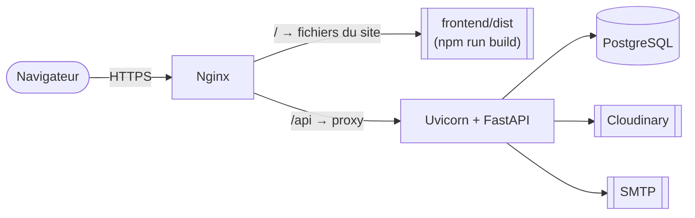

# Maison Guillard — Environnement d'exécution et déploiement

## État actuel : pas d'environnement de production

Le MVP **n'est pas encore en ligne**. Il tourne en local, de façon complète et reproductible :
la base, l'API et le site démarrent avec les commandes du [README](../README.md#installation-en-local).
Ce choix a été fait pour concentrer le temps sur un MVP fonctionnel et testé avant la soutenance du
30 octobre.

| Composant | En local (aujourd'hui) | En production (prévu) |
|---|---|---|
| Base de données | PostgreSQL 16 dans Docker (`docker compose up -d`) | PostgreSQL géré par l'hébergeur, avec sauvegardes |
| API | Uvicorn sur le port 3000, `--reload` | Uvicorn sans `--reload`, derrière Nginx |
| Site | serveur de développement Vite (port 5173), avec un proxy vers l'API | fichiers construits par `npm run build`, servis par Nginx |
| Photos | disque local (`backend/uploads/`) | Cloudinary |
| E-mails | Gmail personnel avec un mot de passe d'application | SMTP de l'hébergeur ou service dédié (Brevo) |
| Connexion | HTTP | **HTTPS** (certificat Let's Encrypt) |

## Architecture de production prévue

En production, le proxy de Vite n'existe plus. **Nginx prend son rôle** : le site et l'API sont
servis sous le même domaine, donc le navigateur ne déclenche pas de blocage CORS.

## Ce qu'il reste à faire pour mettre en ligne

Aucun changement de logique n'est nécessaire. Tout passe par la configuration :

1. **Un `.env` de production** : un nouveau `JWT_SECRET` long et aléatoire (jamais celui de
   développement), `DATABASE_URL` de la base de production, `SMTP_*` de l'hébergeur,
   `EMAIL_ARTISAN` avec la vraie adresse de l'artisane.
2. **La base** : `alembic upgrade head` une fois, puis `seed.py` pour le compte administrateur
   (pas `seed_catalogue.py` : l'artisane saisit son vrai catalogue).
3. **Les photos** : remplacer le corps de `photo_service.upload_to_cloudinary` par l'appel au SDK
   Cloudinary. Sa signature ne change pas.
4. **Le site** : `npm run build`, puis copier `frontend/dist/` sur le serveur.
5. **Nginx** : servir `dist/`, transmettre `/api` et `/uploads` à Uvicorn, activer HTTPS et
   rediriger HTTP vers HTTPS.
6. **Sécurité** : limiter le nombre de requêtes sur `POST /api/commandes` et `POST /api/devis`
   (bug B26 dans [bugs.md](bugs.md)).
7. **Le contenu** : vraies coordonnées dans `frontend/src/config/coordonnees.js`, vraies photos.

La liste complète est dans [evolutions-futures.md](evolutions-futures.md), section « Mise en ligne ».
