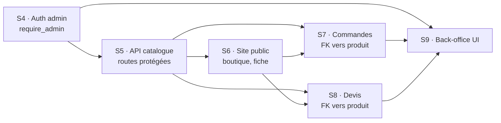

# Maison Guillard — Planification des sprints

> Étape 4 du projet de portfolio : développement du MVP. Ce document découpe le travail en sprints,
> priorise les fonctionnalités (MoSCoW), indique les dépendances, les échéances et les rôles.
> Le détail de chaque sprint est dans `docs/specs/` (conception) et `docs/plans/` (tâches).

## 1. Équipe et rôles

Projet réalisé **seul**. J'ai tenu les quatre rôles demandés ; voici ce que chacun a représenté
concrètement :

| Rôle | Ce que j'ai fait | Traces dans le dépôt |
|---|---|---|
| **Chef de projet (PM)** | Découpage en sprints, priorisation MoSCoW, replanification quand le retard est apparu, suivi du nombre de tâches et de tests. | ce dossier, `docs/specs/`, `docs/plans/` |
| **Responsable Git (SCM)** | Une branche par sprint, Pull Request vers `main`, relecture du diff (`git diff`) avant chaque fusion, Conventional Commits. | 11 Pull Requests, historique `git log` |
| **QA** | TDD (test vu en échec avant le code), tests unitaires et d'intégration, tests manuels dans Swagger et le navigateur, suivi des bugs. | `backend/tests/`, `docs/tests-api.md`, `docs/bugs.md` |
| **Développeur** | Backend (modèles, migrations, services, routes) tapé à la main ; frontend et fichiers de test générés avec une IA à partir de S7, puis relus et expliqués. | `backend/`, `frontend/` |

**Partie prenante (stakeholder)** : l'artisane (ma cousine). Les règles métier ont été décidées avec
elle plutôt que supposées : sens de « sur commande », pas de gestion de stock, paiement hors ligne,
e-mails désactivés par défaut.

## 2. Durée des sprints

- **Prévu** (plan de route du cadrage) : des sprints d'**une semaine**, de S4 à S9.
- **Réel** : S4 et S5 ont suivi ce rythme. Un retard s'est accumulé fin septembre (voir
  `suivi-et-metriques.md`). Le 10 octobre, le reste du MVP a été redécoupé en **blocs de 1 à
  4 jours**, un bloc = un sprint, avec la même méthode.

## 3. Priorisation MoSCoW

| Priorité | Fonctionnalité | Sprint | État |
|---|---|---|---|
| **Must have** | Authentification de l'administratrice (JWT + bcrypt) | S4 | ✅ |
| | API catalogue : produits, catégories, photos | S5 | ✅ |
| | Site public : boutique, filtres, fiche produit | S6 | ✅ |
| | Achat direct : panier, commande, confirmation | S7 | ✅ |
| | Demande de devis | S8 | ✅ |
| | Back-office : produits, commandes, devis | S9 | ✅ |
| **Should have** | Vitrine (accueil, qui sommes-nous, contact) | S6 | ✅ |
| | E-mails automatiques, activables par l'artisane | S7–S8 | ✅ |
| | Documentation Swagger en français, tests manuels de l'API | S6 | ✅ |
| | Interface responsive | S6–S9 | ✅ |
| **Could have** | Animations (fondu des photos, glissement entre pages) | S7 | ✅ |
| | Gestion des catégories dans le back-office | — | reportée (Swagger suffit pour 4 catégories) |
| | Pagination et recherche dans le back-office | — | reportée |
| | Hébergement des photos sur Cloudinary | S5 | remplacé par un stockage local, une fonction à changer |
| **Won't have (pour ce MVP)** | Comptes clients et historique de commandes | — | évolution future |
| | Paiement en ligne | — | réglé directement avec l'artisane |
| | Gestion de stock | — | décision de l'artisane : elle passe le produit en « rupture » |
| | Plusieurs administrateurs avec des rôles | — | un seul compte suffit |

## 4. Dépendances entre les tâches

- Les routes d'écriture du catalogue (S5) ont besoin de `require_admin` (S4).
- Les pages publiques (S6) consomment l'API du catalogue (S5).
- Une commande (S7) et un devis (S8) pointent vers un produit : la table `produit` doit exister.
- Le back-office (S9) affiche les commandes et les devis : il vient en dernier.

## 5. Plan des sprints

### Sprint 0 — Cadrage (21 août → 13 septembre)

Hors du dépôt (`Documentation/`) : document MVP, documentation technique (jalon du 10 septembre),
plan de route. Modèle de données, liste des routes, user stories.

### Sprint 1 — S4 : initialisation et authentification (14 → 17 septembre)

**Objectif** : un projet qui démarre et une administratrice qui peut se connecter.

| # | Tâche | Dépend de |
|---|---|---|
| 1 | Squelette FastAPI, environnement Python, `GET /api/health` | — |
| 2 | Session SQLAlchemy, modèle `Admin`, première migration Alembic | 1 |
| 3 | `auth_service` : bcrypt, création et vérification du JWT | 2 |
| 4 | Dépendance `require_admin` et `POST /api/auth/login` | 3 |
| 5 | Script `seed.py` du compte admin | 2 |
| 6 | Squelette frontend React + Vite, page de connexion | 4 |
| 7 | Documentation et fusion | 1–5 |

La tâche 6 a été **reportée** : le backend a été priorisé (MVP-first). Le frontend a démarré en S6
et la page de connexion est arrivée avec le back-office en S9.

### Sprint 2 — S5 : API du catalogue (22 septembre → 6 octobre)

**Objectif** : l'artisane peut gérer catégories, produits et photos par l'API.

| # | Tâche | Dépend de |
|---|---|---|
| 1 | Modèles `Categorie`, `Produit`, `Photo` + migration | S4 |
| 2 | `categorie_service` (suppression refusée si utilisée) | 1 |
| 3 | Routes des catégories | 2 |
| 4 | `produit_service` (filtres, mise à jour partielle) | 1 |
| 5 | Routes des produits | 4 |
| 6 | `photo_service` (stockage local, une seule photo principale) | 1 |
| 7 | Routes des photos et fichiers statiques | 6 |
| 8 | Documentation et fusion | 1–7 |
| + | 5 correctifs après relecture (6 octobre) : voir `docs/bugs.md` | 3, 5 |

### Sprint 3 — S6 : site public, vitrine et qualité de l'API (10 → 13 octobre)

**Objectif** : un visiteur parcourt le catalogue ; l'API est documentée et testée à la main.

| # | Tâche | Dépend de |
|---|---|---|
| 1 | Produits renvoyés avec leurs photos | S5 |
| 2 | Seed du catalogue de démonstration | 1 |
| 3 | Squelette frontend, client API, règles d'affichage | 1 |
| 4 | Page boutique avec filtres | 3 |
| 5 | Fiche produit avec galerie | 3 |
| 6 | Direction artistique : polices, couleurs, logo | — |
| 7 | Entête, pied de page, routes, boutique sous `/boutique` | 6 |
| 8 | Accueil (vitrine) | 7 |
| 9 | Pages « Qui sommes-nous » et « Contact » | 7 |
| 10 | Tests de sécurité : chaque route admin sans jeton et avec un faux jeton | S5 |
| 11 | Swagger en français, rapport de tests manuels `docs/tests-api.md` | S5 |

### Sprint 4 — S7 : achat direct (20 → 23 octobre)

**Objectif** : un visiteur passe une commande ; l'artisane est prévenue par e-mail.

| # | Tâche | Dépend de |
|---|---|---|
| 1 | Tables `commande`, `ligne_commande`, `parametre` + migration | S5 |
| 2 | Supprimer un produit déjà commandé → 409 | 1 |
| 3 | Schémas et `commande_service` (prix relu en base) | 1 |
| 4 | `POST /api/commandes` | 3 |
| 5 | Réglage des e-mails (`parametre_service`, routes admin) | 1 |
| 6 | E-mails de commande en tâche de fond | 4, 5 |
| 7 | Règles du panier (`utils/panier.js`) et tests | — |
| 8 | Contexte du panier, pastille, bouton « Ajouter au panier » | 7 |
| 9 | Page panier | 8 |
| 10 | Formulaire de commande et confirmation | 4, 9 |
| 11 | Test complet avec un vrai e-mail, documentation | 1–10 |

### Sprint 5 — S8 : demande de devis (23 → 26 octobre)

**Objectif** : un visiteur demande un devis, lié ou non à un produit.

| # | Tâche | Dépend de |
|---|---|---|
| 1 | Table `devis` + migration (`SET NULL` vers le produit) | S5 |
| 2 | Schémas et `devis_service` | 1 |
| 3 | `POST /api/devis` et e-mails | 2, S7-6 |
| 4 | Formulaire de devis sur la page Contact | 3 |
| 5 | Vérification manuelle et documentation | 1–4 |

### Sprint 6 — S9 : back-office (26 octobre)

**Objectif** : l'artisane gère tout depuis une interface, sans Swagger.

| # | Tâche | Dépend de |
|---|---|---|
| 1 | Commandes : liste et changement de statut (API) | S7 |
| 2 | Devis : liste et changement de statut (API) | S8 |
| 3 | Connexion et structure du back-office | S4 |
| 4 | Gestion des produits et des photos | 3 |
| 5 | Suivi des commandes et des devis | 1, 2, 3 |
| 6 | Vérification manuelle, documentation, Pull Request | 1–5 |

### Sprint 7 — Finition (26 → 30 octobre)

Nouvelles photos de l'accueil, entête transparent, pied de page ; guide de préparation de la
soutenance ; liste des évolutions futures (PR #9, #10, #11).

## 6. Échéances

| Échéance | Date |
|---|---|
| Jalon documentation technique | 10 septembre 2026 |
| Fin prévue du développement (plan de route) | 21 octobre 2026 |
| MVP complet sur `main` (fin de S9) | 26 octobre 2026 |
| Soutenance | 30 octobre 2026 |
