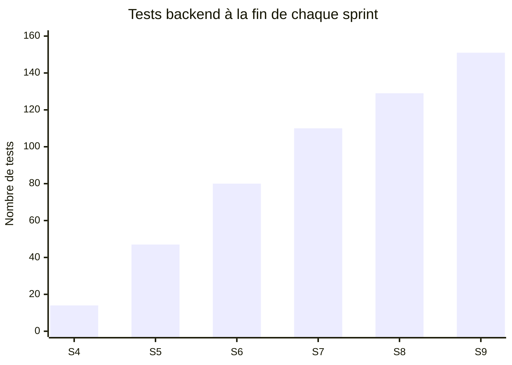

# Maison Guillard — Suivi de l'avancement et métriques

> Comment l'avancement a été suivi, les chiffres de chaque sprint, et les ajustements faits quand
> le plan n'a pas tenu.

## 1. Outils de suivi

Je n'ai pas utilisé Trello ni Jira. Seul sur le projet, j'ai suivi l'avancement directement dans
le dépôt :

| Besoin | Outil utilisé |
|---|---|
| Liste des tâches d'un sprint | le plan du sprint (`docs/plans/`), une tâche par section |
| Tâche terminée | un commit par tâche, visible dans `git log` |
| Fin de sprint | une Pull Request fusionnée dans `main` |
| Bilan d'un sprint | le résumé du sprint (`docs/2026-…-resume.md`) |
| Bugs | `docs/bugs.md` |

**Point de début de séance (équivalent du daily stand-up).** Sans équipe, il n'y avait pas de
réunion. Chaque séance de travail commençait par les trois questions du stand-up : qu'est-ce qui
est fini depuis la dernière fois (`git log`, `git status`), qu'est-ce qui bloque, quel est
l'objectif de la séance. Les blocages rencontrés sont notés dans les résumés de sprint, rubrique
« Erreurs rencontrées ».

## 2. Métriques par sprint

**Vélocité** = nombre de tâches terminées dans le sprint.

| Sprint | Dates | Tâches prévues | Tâches terminées | % | Tests backend (fin) | Tests frontend (fin) | Bugs trouvés | PR |
|---|---|---|---|---|---|---|---|---|
| S4 — Auth | 14–17 sept | 7 | 6 | 86 % | 14 | — | 1 | (sur `main`) |
| S5 — API catalogue | 22 sept–6 oct | 8 | 8 + 5 correctifs | 100 % | 47 | — | 7 | #1, #2 |
| S6 — Site public, qualité API | 10–13 oct | 11 | 11 | 100 % | 80 | 10 | 5 | #3, #4, #5 |
| S7 — Achat direct | 20–23 oct | 11 | 11 | 100 % | 110 | 19 | 5 | #6 |
| S8 — Devis | 23–26 oct | 5 | 5 | 100 % | 129 | 23 | 1 | #7 |
| S9 — Back-office | 26 oct | 6 | 6 | 100 % | 151 | 27 | 2 | #8 |
| **Total** | | **48** | **47** | **98 %** | **151** | **27** | **21** | **8** |

La tâche non terminée en S4 est la page de connexion du frontend : reportée volontairement, elle
a été livrée en S9 avec le back-office.

**Bugs** : 28 enregistrés, 21 corrigés (taux de résolution de **75 %**), dont les 6 bugs
bloquants. Les 7 ouverts sont des limites connues, sans erreur 500 ni perte de données (détail
dans `docs/bugs.md`). Le dernier (B28) a été trouvé par l'artisane pendant la présentation du
site, le 2 novembre.

**Croissance des tests backend**

## 3. Écarts au plan et ajustements

| Date | Écart constaté | Ajustement |
|---|---|---|
| 14 sept | La documentation technique prévoyait Node.js/Express/Prisma. | Passage à Python/FastAPI/SQLAlchemy dès le début de S4, avant tout code métier (commit `2341dbf`). Le modèle de données et les routes restent ceux de la documentation. |
| 17 sept | Le frontend de S4 n'est pas commencé. | Priorité au backend (MVP-first) : la page de connexion est reportée. |
| 25 sept → 6 oct | S5 fusionnée, puis une relecture trouve 5 défauts (500 au lieu de 409/422, migration, base de test). | Une passe de correctifs avant de continuer, plutôt que de construire le site sur une API fragile. |
| 10 oct | **Retard sur le plan de route** : le plan prévoyait déjà la semaine de tests et de documentation, alors que le site public n'était pas commencé. | Le reste du MVP est **redécoupé en 5 blocs courts** (site public, achat direct, devis, back-office UI, back-office commandes et devis), chacun avec sa conception, son plan et sa PR. |
| 20–23 oct | L'artisane demande une nouvelle direction artistique (noir et blanc) pendant l'achat direct. | Ajoutée au sprint, car presque tout tient dans les variables de couleur de `index.css`. |
| 23 oct | Le jury approche (30 oct). | Devis volontairement **basique** (S8), construit pour être enrichi plus tard. |
| 26 oct | Le back-office complet ne tient pas en une journée. | Périmètre réduit à **l'essentiel** : les catégories restent gérées dans Swagger, la pagination est reportée. |
| 29 oct | Le manager propose des comptes clients. | Reporté après le MVP et noté comme évolution future : trop risqué la veille de la soutenance. |

## 4. Ce que montrent les chiffres

- **La vélocité a augmenté après le redécoupage** : des blocs plus petits, avec un plan précis,
  se terminent en 1 à 4 jours au lieu d'une semaine.
- **Le nombre de bugs par sprint baisse** (7 en S5, 1 en S8) : les erreurs de S5 ont donné des
  réflexes (tester les cas d'erreur, relire le diff avant chaque fusion).
- **Chaque sprint a été fusionné avec tous ses tests au vert**, après relecture du diff.
