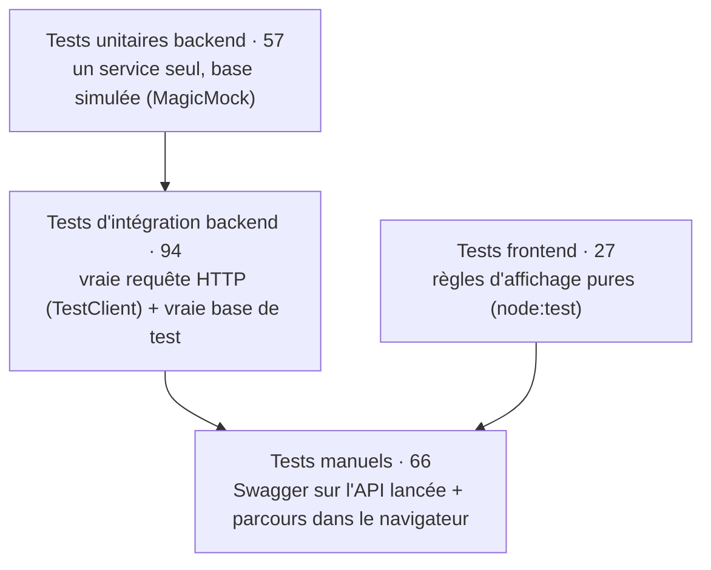

# Maison Guillard — Stratégie et résultats des tests

> Comment l'application a été testée, ce qui est vérifié, et les résultats. Les sorties brutes de
> la dernière exécution sont dans `docs/preuves-tests/`.

## Dernière exécution — 2 novembre 2026, branche `main`

| Suite | Commande | Résultat | Preuve |
|---|---|---|---|
| Backend (pytest) | `cd backend; .\.venv\Scripts\python.exe -m pytest -v` | **151 passed**, 0 échec, en 27 s | [`2026-11-02-pytest.txt`](preuves-tests/2026-11-02-pytest.txt) |
| Frontend (node:test) | `cd frontend; npm test` | **27 pass**, 0 échec | [`2026-11-02-node-test.txt`](preuves-tests/2026-11-02-node-test.txt) |
| Manuels (Swagger + navigateur) | voir `docs/tests-api.md` | **66 vérifications, 66 PASS** | [`tests-api.md`](tests-api.md) |

Environnement : Windows 11, Python 3.14, Node.js 25, PostgreSQL 16 dans Docker.

## 1. La stratégie : quatre niveaux

| Niveau | Ce qu'il prouve | Exemple |
|---|---|---|
| **Unitaire** | Une règle métier est juste, isolée du reste. Rapide, sans base de données. | `test_categorie_service.py` : supprimer une catégorie utilisée lève une erreur |
| **Intégration** | Toute la chaîne fonctionne : route → schéma → service → vraie base PostgreSQL → réponse HTTP. | `test_commandes_routes.py` : `POST /api/commandes` répond 201, le total est calculé avec les prix de la base |
| **Frontend** | Les règles d'affichage sont justes, sans navigateur. | `produit.test.js` : un produit `sur_commande` n'affiche jamais le bouton panier |
| **Manuel** | L'application lancée se comporte comme prévu pour un vrai utilisateur, e-mails compris. | commande passée depuis le site, deux e-mails reçus dans Gmail |

**Base de test séparée.** Les tests d'intégration utilisent la base `maison_guillard_test`, jamais
la base de développement. Une fixture `clean_db` vide les tables avant chaque test, pour que chaque
test parte d'un état connu. Le `conftest.py` racine force cette base pour tous les fichiers (bug
B08 dans `docs/bugs.md`).

**Ce qui est remplacé par un faux** : la base de données dans les tests unitaires (`MagicMock`) et
le serveur SMTP (`unittest.mock.patch`) : aucun test n'envoie de vrai e-mail.

**TDD.** Chaque test a été écrit avant le code et **vu en échec** (rouge), puis le code minimal a
été écrit pour le faire passer (vert). Un test qui n'a jamais échoué ne prouve pas qu'il teste
quelque chose.

## 2. Ce qui est testé, fichier par fichier

### Backend — tests unitaires (57)

| Fichier | Tests | Ce qui est vérifié |
|---|---|---|
| `test_auth_service.py` | 7 | hachage bcrypt aller-retour, mauvais mot de passe, e-mail inconnu, jeton créé puis décodé, jeton invalide refusé |
| `test_categorie_service.py` | 6 | liste, création, slug en double (annulation de la transaction), suppression refusée si la catégorie est utilisée |
| `test_produit_service.py` | 8 | création, lecture, **mise à jour partielle** (seuls les champs envoyés changent), suppression, catégorie inexistante |
| `test_photo_service.py` | 6 | enregistrement du fichier, ajout et suppression, **une seule photo principale par produit** |
| `test_commande_schema.py` | 8 | une commande valide, puis une série de commandes invalides refusées (quantité hors de 1 à 10, aucune ligne, produit en double, champs vides) |
| `test_commande_service.py` | 6 | **prix pris en base** et total calculé, produit indisponible ou inconnu refusé, changement de statut |
| `test_devis_schema.py` | 5 | une demande valide, puis des demandes invalides refusées |
| `test_devis_service.py` | 6 | demande sans produit, produit inconnu refusé, toutes les disponibilités acceptées, changement de statut |
| `test_email_service.py` | 5 | contenu des e-mails (commande, devis, devis sans produit), envoi SMTP avec STARTTLS, une panne SMTP ne lève jamais d'erreur |

### Backend — tests d'intégration (94)

| Fichier | Tests | Ce qui est vérifié |
|---|---|---|
| `test_securite_et_erreurs.py` | 28 | **chacune des 14 routes admin refuse une requête sans jeton et une requête avec un jeton falsifié (401)** |
| `test_produits_routes.py` | 14 | liste, filtres, détail avec photos triées, création, modification partielle, suppression (photos comprises), 404, 422 |
| `test_commandes_routes.py` | 8 | création de commande, prix relus en base, refus des produits indisponibles, e-mails selon le réglage |
| `test_devis_routes.py` | 8 | devis avec ou sans produit, refus des données invalides, **le devis reste quand son produit est supprimé**, e-mails selon le réglage, devis créé même si le serveur SMTP est injoignable |
| `test_categories_routes.py` | 7 | liste publique, création admin, 409 slug pris, 409 catégorie utilisée |
| `test_auth_routes.py` | 6 | connexion 200, mauvais mot de passe 401, e-mail inconnu 401, mot de passe manquant 422, route protégée avec et sans jeton |
| `test_commandes_admin.py` | 5 | liste admin, tri, filtre par statut, changement de statut, 404 |
| `test_devis_admin.py` | 5 | idem pour les devis |
| `test_seed_catalogue.py` | 5 | le seed du catalogue est relançable sans doublons |
| `test_photo_routes.py` | 4 | **upload d'un vrai fichier**, puis relecture du fichier servi |
| `test_parametres_routes.py` | 2 | lecture et modification du réglage e-mail |
| `test_health.py` | 1 | l'API répond |
| `test_suppression_produit_commande.py` | 1 | supprimer un produit déjà commandé → 409, rien n'est supprimé |

### Frontend (27)

| Fichier | Tests | Ce qui est vérifié |
|---|---|---|
| `produit.test.js` | 10 | prix et libellés selon la disponibilité, boutons proposés, choix des photos, pièces mises en avant |
| `panier.test.js` | 6 | ajout, quantité limitée à 10, retrait et total, panier corrompu dans le `localStorage` remplacé par un panier vide, **seuls `produit_id` et `quantite` sont envoyés à l'API** |
| `admin.test.js` | 4 | libellés des statuts, format des dates, conversion du formulaire produit |
| `erreurs.test.js` | 4 | traduction des erreurs de l'API en messages français |
| `navigation.test.js` | 3 | sens du glissement entre les pages |

## 3. Tests de bout en bout (intégration frontend + backend)

Faits à la main dans le navigateur, avec le backend et la base réels, à la fin de chaque sprint
(détail dans `docs/tests-api.md`, sections 15 à 19) :

1. **Boutique** : filtres, fiche produit, galerie de photos.
2. **Achat** : ajout au panier, modification des quantités, commande, page de confirmation, panier
   vidé, deux e-mails reçus.
3. **Devis** : depuis une pièce sur commande, vendue et disponible ; produit pré-rempli ;
   e-mails reçus.
4. **Back-office** : connexion, création d'un produit et de ses photos, modification du prix,
   message 409 en supprimant un produit déjà commandé, changement de statut d'une commande et d'un
   devis, déconnexion puis retour sur `/admin` → page de connexion.

## 4. Les opérations de base de données sous différentes conditions

| Condition | Résultat attendu | Vérifié par |
|---|---|---|
| Supprimer un produit qui a des photos | les photos sont supprimées aussi (`CASCADE`) | `test_produits_routes.py` |
| Supprimer un produit déjà commandé | refusé, 409, rien n'est supprimé | `test_suppression_produit_commande.py` |
| Supprimer un produit lié à un devis | le devis reste, `produit_id` devient vide (`SET NULL`) | `test_devis_routes.py` |
| Supprimer une catégorie utilisée | refusé, 409 | `test_categories_routes.py` |
| Slug en double | refusé, 409 (contrainte d'unicité) | `test_categories_routes.py` |
| Valeur hors énumération (`disponibilite=foo`) | refusé, 422 | `test_produits_routes.py` |
| Migration aller-retour (`downgrade` puis `upgrade`) | aucune erreur, types énumérés supprimés | vérifié à la main à chaque migration |
| Relancer le seed du catalogue | aucun doublon | `test_seed_catalogue.py` |

## 5. Ce qui n'est pas encore couvert

- Pas de tests automatisés des composants React dans un navigateur (par exemple Playwright) : les
  parcours sont vérifiés à la main.
- Pas de test de charge.
- Les limites connues de validation (prix négatif, nom vide, format du slug) n'ont pas encore de
  test, puisqu'elles ne sont pas corrigées : voir `docs/bugs.md`, B22 à B24.
